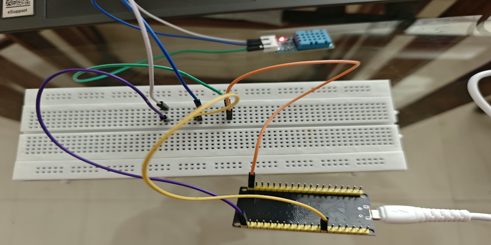
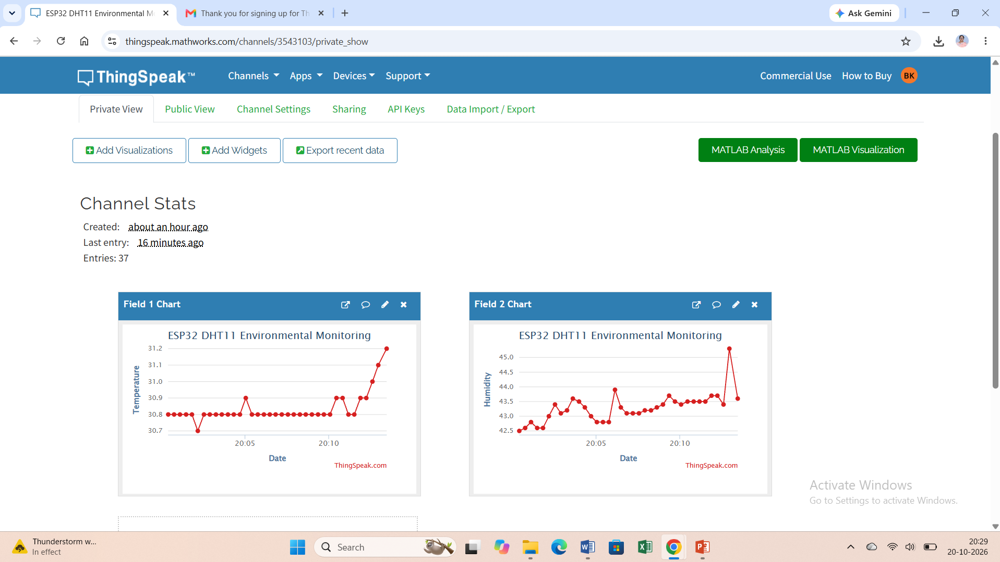
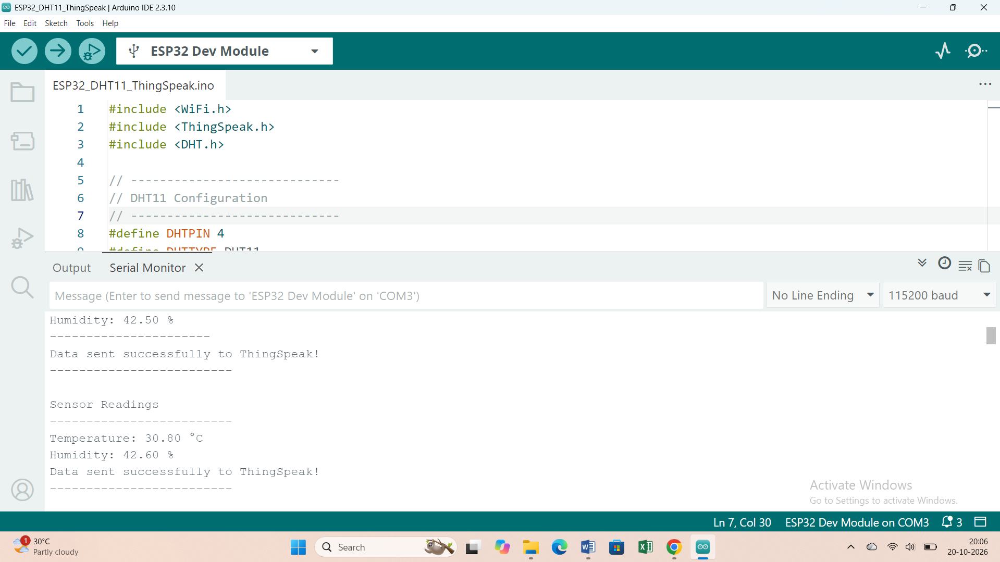

# ESP32 + DHT11 + ThingSpeak IoT Monitoring

## Project Overview
This project uses an ESP32 and DHT11 sensor to measure temperature and humidity. The readings are displayed in the Arduino Serial Monitor and uploaded to ThingSpeak for cloud visualization.

## Hardware Requirements
- ESP32 development board
- DHT11 temperature and humidity sensor
- Breadboard and jumper wires
- USB data cable
- Wi-Fi connection

## Circuit Connections


| DHT11 | ESP32 |
|---|---|
| VCC | 3V3 |
| GND | GND |
| DATA | GPIO 4 |

Check the pin labels on your particular sensor module before connecting it.

## Software Requirements
- Arduino IDE
- ESP32 board support
- DHT sensor library by Adafruit
- ThingSpeak library

## ThingSpeak Configuration
1. Create a ThingSpeak channel.
2. Enable Field 1 and name it Temperature.
3. Enable Field 2 and name it Humidity.
4. Obtain your Channel ID and Write API Key.
5. Enter your credentials locally in the Arduino sketch.
**Security:** Never publish your actual Wi-Fi password or ThingSpeak Write API Key.

## Execution Steps
1. Connect the DHT11 to the ESP32.
2. Open the Arduino sketch in Arduino IDE.
3. Select the correct ESP32 board and COM port.
4. Configure your Wi-Fi and ThingSpeak credentials.
5. Upload the sketch.
6. Open Serial Monitor at 115200 baud.
7. Verify the readings and view the graphs in ThingSpeak Private View.

## Expected Output
Example values; actual readings will vary.


```text
Temperature: 30.80 °C
Humidity: 42.50 %
Data sent successfully to ThingSpeak!
```

## Learning Outcomes
- Sensor interfacing with ESP32
- Wi-Fi communication
- Cloud data upload
- IoT data visualization

## Author
Dr. Bharati Pandurang Kawade
Assistant Professor, Department of Computer Applications
Vishwakarma University, Pune, Maharashtra, India

Project: ESP32-Based Temperature and Humidity Monitoring Using DHT11 and ThingSpeak
Technologies: ESP32, Arduino IDE, DHT11, Wi-Fi, ThingSpeak IoT Cloud
